# GRITSENSE — Volleyball Intelligence Platform

> **Turn a broadcast volleyball video into live tactical advice.**
> Player tracking · Pose estimation · Ball flight physics · Graph neural networks · LLM commentary · Web dashboard

---

## Table of Contents

1. [Overview](#1-overview)
2. [Pipeline Architecture](#2-pipeline-architecture)
3. [Key Features](#3-key-features)
4. [Project Structure](#4-project-structure)
5. [Requirements](#5-requirements)
6. [Installation](#6-installation)
7. [Quick Start](#7-quick-start)
8. [Running the Full Pipeline (CLI)](#8-running-the-full-pipeline-cli)
9. [Web Application](#9-web-application)
10. [Model Details](#10-model-details)
11. [Physics EPV Model](#11-physics-epv-model)
12. [Commentary Engine](#12-commentary-engine)
13. [Outputs](#13-outputs)
14. [Troubleshooting](#14-troubleshooting)
15. [References](#15-references)

---

## 1. Overview

GRITSENSE is a full-stack volleyball analytics platform built as a capstone project. Given a broadcast match video (1080p, 30 fps), it:

1. **Detects and tracks** every player, their 17-point body pose, and the ball
2. **Recovers the court geometry** via homography and camera calibration — converting pixel positions to real court metres
3. **Cleans the ball track** using physics-aware dynamic programming and gap interpolation
4. **Builds interaction graphs** (49-feature nodes, 4-feature edges) and trains Graph Attention Network (GAT) + Hierarchical Relational Network (HRN) models *without any manual labels*
5. **Runs a Physics EPV model** evaluating 1,296 target cells × 5 shot types per frame to recommend where and how to attack
6. **Detects ball touches** (pass, set, attack), possession, and rally phase
7. **Classifies group activity** (l/r set, spike, pass, winpoint) using a pretrained GAT checkpoint
8. **Generates LLM commentary** offline via `Qwen2.5-3B-Instruct` (no API key needed)
9. **Renders a 1920 × 1080 dashboard video** with all overlays, matchups, team shape, EPV heat map, and synced commentary
10. **Serves everything through a Flask web app** with live progress, job archive, and video playback

Tested on: 2022 FIVB Men's World Championship · Brazil vs Japan · 319 frames @ 30 fps

---

## 2. Pipeline Architecture

```mermaid
flowchart LR
    V["Broadcast video\n319 frames @ 30 fps"]

    subgraph PER["1. Perception"]
        P1["YOLO player\n+ BoT-SORT tracker"]
        P2["YOLO pose\n17 COCO keypoints"]
        P3["YOLO ball\nmulti-scale re-detect"]
        P4["Court homography\nhand-annotated corners"]
    end

    subgraph CLEAN["2. Ball Truth"]
        C1["Static-object rejection"]
        C2["Physical speed gate"]
        C3["Dynamic-programming path"]
        C4["Quadratic gap fill"]
    end

    subgraph STATE["3. State Representation"]
        S1["49-D interaction graph\nplayers + ball, 4-D edges"]
        S2["GAT · 2 layers · 4 heads"]
        S3["HRN player → team → scene"]
        S4["8-frame temporal windows"]
    end

    subgraph DECIDE["4. Decision Layer"]
        D1["Touch detection\npass / set / attack"]
        D2["Possession + phase\nstate machine"]
        D3["Physics EPV\n1296 cells × 5 shots"]
        D4["Matchups + team shape"]
        D5["Skill-scaled blend\nHRN / GAT + physics"]
    end

    subgraph OUT["5. Presentation"]
        O1["1920×1080 dashboard video"]
        O2["dashboard_insights.json"]
        O3["LLM commentary (offline)"]
        O4["Flask web app + job queue"]
    end

    V --> PER --> CLEAN --> STATE --> DECIDE --> OUT
```



---

## 3. Key Features

| Feature | Detail |
|---|---|
| **Player tracking** | YOLO `player_detection.pt` + BoT-SORT; ≤ 6 players per team, filtered to on-court |
| **Pose estimation** | 17 COCO keypoints per player via YOLO `pose.pt` |
| **Ball tracking** | Multi-scale (640/1280/1920 px) YOLO `ball.pt` → physics DP path → 317/319 frames |
| **Homography & camera** | 3×3 matrix; focal length 2 500 px; camera position stable to ~1 m over 319 frames |
| **Touch detection** | Velocity deflection + 3-D reach check; 7/10 correct (3 false positives) |
| **Physics EPV** | P(land in) × (1 − P(blocked)) × P(no defender reaches it); 1 296 cells × 5 shots |
| **GAT** | 2-layer, 4-head; self-supervised movement prediction; test ADE 0.87 m |
| **HRN** | Distilled from physics; zone acc 46% · shot acc 92% · shape MAE 0.066 |
| **Pretrained group-activity GAT** | RCRG-R2-C11-conc-temporal-V1 from Volleyball Dataset; 9-frame windows |
| **Commentary LLM** | `Qwen/Qwen2.5-3B-Instruct` fully offline; template fallback; runs on CUDA or CPU |
| **Dashboard video** | 1920 × 1080; EPV heat map, court map, matchups, team shape, rally timeline |
| **Web app** | Flask; upload video, annotate court, live progress bar, archive with downloads |

---

## 4. Project Structure

```
GRITSENSE/
│
├── master_main.py              # Orchestrates the full pipeline end-to-end
├── requirements.txt
│
├── pipeline/                   # Processing stages
│   ├── ball_tracker.py         # YOLO tracking + BoT-SORT
│   ├── redetect_ball.py        # Multi-scale ball re-detection
│   ├── clean_ball_track.py     # Physics-aware ball cleaning
│   ├── graph_builder.py        # 49-feature interaction graph construction
│   ├── integrate_and_rebuild.py# GAT + HRN inference on graphs
│   ├── group_activity.py       # Pretrained group-activity GAT
│   ├── tactical_dashboard.py   # Dashboard video renderer
│   ├── calibrate_physics.py    # Measure physics constants from video
│   ├── train_gat_hrn.py        # Self-supervised GAT / HRN training
│   ├── sample_data.py          # Shared data loading utilities
│   ├── visualize_recent_graphs.py
│   ├── device_selection.py     # XPU / CUDA / CPU device selector
│   └── pipeline_profiling.py   # Optional timing instrumentation
│
├── analytics/                  # Physics & AI analytics engine
│   ├── constants.py            # All physical constants (measured / published / derived)
│   ├── epv.py                  # Expected Point Value model
│   ├── camera.py               # Camera recovery from homography
│   ├── ball_track.py           # Ball path selection & cleaning
│   ├── motion.py               # Velocity smoothing
│   ├── pose_signals.py         # Jump detection from pose
│   ├── insights.py             # Matchups, team shape, hybrid blend
│   ├── relations.py            # Player–player relational features
│   ├── commentary.py           # LLM + template commentary
│   ├── nlp.py                  # Prompt construction & LLM interface
│   ├── learned.py              # Trained model loading & inference
│   └── physics_calibration.json# Auto-generated by calibrate_physics.py
│
├── models/                     # GAT / HRN model definitions
│   ├── gat.py
│   ├── hrn.py
│   └── attention_models/       # Pretrained relational attention layers
│
├── temporal/                   # Temporal sequence models
│
├── weights/                    # Pre-trained YOLO weights
│   ├── player_detection.pt
│   ├── pose.pt / yolov8n-pose.pt
│   └── ball.pt
│
├── checkpoints/                # Trained GAT + HRN weights
│   ├── gat.pt
│   ├── hrn.pt
│   ├── training_report.json
│   └── training_curves.png
│
├── pretrained_checkpoints/     # Group-activity GAT checkpoint
│   └── RCRG-R2-C11-conc-temporal-V1/
│       └── checkpoint_epoch_42.pkl
│
├── data/                       # Input data files
│   ├── sample3.mp4             # Bundled sample match video
│   ├── annotations.json        # Court corner annotations (per-frame)
│   ├── court.png               # Mini-court image
│   ├── ball.csv                # Raw ball detections
│   ├── ball_clean.csv          # Cleaned ball track (auto-generated)
│   └── player_keypoints_mf3_pose.json
│
├── webapp/                     # Flask web application
│   ├── server.py               # App server + job queue
│   ├── jobs/                   # Per-job outputs (video, commentary, insights)
│   └── static/                 # Frontend (HTML, CSS, JS, assets)
│
├── docs/
│   ├── RUN_GUIDE.md            # Detailed run instructions
│   ├── SYSTEM_EXPLAINED.md     # Viva Q&A — deep technical explanations
│   └── demo/                   # Demo videos
│
└── output_recent/              # Latest pipeline outputs (auto-generated)
    ├── dashboard/              # gritsense_dashboard.mp4, commentary.txt, etc.
    ├── group_activity/
    └── graphs/
```

---

## 5. Requirements

- **OS:** Windows 10/11 · macOS · Linux
- **Python:** 3.10 or newer (tested on 3.13)
- **Disk:** ~5 GB (models + optional local LLM ~6 GB on first run)
- **GPU:** Optional — detection prefers Intel XPU → NVIDIA CUDA → CPU; LLM uses CUDA or CPU

---

## 6. Installation

```powershell
# Clone / download the repo, then open a terminal in the project folder

# 1. Create and activate a virtual environment
python -m venv .venv
.venv\Scripts\activate          # Windows
# source .venv/bin/activate     # macOS / Linux

# 2. Install dependencies
pip install -r requirements.txt
```

**`requirements.txt` covers:**
`opencv-python` · `ultralytics` · `torch` · `supervision` · `numpy` · `torch_geometric` · `pillow` · `matplotlib` · `transformers` · `flask` · `imageio-ffmpeg`

> [!NOTE]
> The local LLM (`Qwen/Qwen2.5-3B-Instruct`, ~6 GB) is downloaded on first run into your Hugging Face cache. No API key needed. Subsequent runs load from cache without network access.

---

## 7. Quick Start

### Web App (Recommended)

```powershell
cd e:\capstone-4\GRITSENSE
.venv\Scripts\activate
python webapp/server.py
```

Open **http://127.0.0.1:5000** in your browser.

From the UI you can:
- **Use sample match** — renders the full dashboard from the bundled `data/sample3.mp4` in ~4–7 minutes
- **Upload your own video** — drop a match video, click the four court corners on a frame, set team names, pick compute device, and press **Run Analysis**
- **Follow live progress** — real-time log stream with per-stage progress bar
- **Browse results** — dashboard video with synced commentary, EPV timeline (click to seek), recommended plays, matchups, snapshots, downloads

### CLI Quick Test (dashboard only, first 90 frames)

```powershell
python pipeline/tactical_dashboard.py --max-frames 90 --show
```

---

## 8. Running the Full Pipeline (CLI)

### A. Full pipeline — video → detection → graphs → dashboard

```powershell
python master_main.py --video data/sample3.mp4 --dashboard
```

**Stages run:**
1. Player tracking + pose (writes `data/player_keypoints_mf3_pose.json`, `data/ball.csv`)
2. Ball re-detection & cleaning (writes `data/ball_clean.csv`)
3. Graph pipeline — 49-feature graphs → GAT → HRN embeddings
4. Graph visualisations
5. Group-activity GAT (pretrained, writes `output_recent/group_activity/group_activity.json`)
6. Tactical dashboard (writes `output_recent/dashboard/gritsense_dashboard.mp4`)

### B. Dashboard only (uses existing detections)

```powershell
python master_main.py --dashboard-only
# or directly:
python pipeline/tactical_dashboard.py
```

### C. Improve ball tracking

```powershell
python pipeline/redetect_ball.py     # ~2–3 min on CPU
```

Runs `ball.pt` at 640/1280/1920 px, rejects static false positives, picks the physically consistent path, fills gaps up to 8 frames.

### D. Calibrate physics from your video

```powershell
python pipeline/calibrate_physics.py
```

Measures top speed, standing height, and block-jump height from the video. Writes `analytics/physics_calibration.json`, which the EPV model loads automatically.

### E. Train the GAT and HRN (no labels needed)

```powershell
python pipeline/train_gat_hrn.py
```

~2–3 minutes on CPU. Writes `checkpoints/gat.pt`, `checkpoints/hrn.pt`, `checkpoints/training_report.json`.

### F. Group-activity classification

```powershell
python pipeline/group_activity.py --video data/sample3.mp4 --device auto
```

### Useful CLI Options

| Option | Example | Effect |
|---|---|---|
| `--video` | `--video data/match2.mp4` | Input video |
| `--teams` | `--teams BRA JPN` | Team labels (left, right) |
| `--max-frames` | `--max-frames 150` | Render only the first N frames |
| `--show` | `--show` | Live preview while rendering |
| `--nlp` | `--nlp template` | Commentary engine (`local` / `template`) |
| `--local-model` | `--local-model Qwen/Qwen2.5-7B-Instruct` | Swap the LLM |
| `--learned-weight` | `--learned-weight 0.5` | GAT/HRN influence in hybrid (default 0.3) |
| `--physics-only` | `--physics-only` | Disable GAT/HRN, physics-only mode |
| `--device` | `--device cuda` | Force compute device (`auto`/`cpu`/`cuda`/`xpu`) |
| `--profile` | `--profile` | Enable timing profiling |

### Performance Profiling

```powershell
# Web app
$env:GRITSENSE_PROFILE = "1"
python webapp/server.py

# Direct run
python master_main.py --video data/sample3.mp4 --profile --dashboard
```

---

## 9. Web Application

The Flask app at `webapp/server.py` provides a full browser UI:

| Feature | Detail |
|---|---|
| **Job queue** | One job at a time; a background thread runs `master_main.py` as a subprocess |
| **Live log streaming** | Per-job log streamed to the UI via polling |
| **Court annotation** | Click 4 court corners on a video frame directly in the browser |
| **Device selection** | Auto / CPU / CUDA / Intel Arc XPU |
| **Job archive** | All past runs in `webapp/jobs/<id>/`; view, replay, download |
| **Sample backup** | Sample detection files backed up to `webapp/sample_backup/` so sample runs stay accurate |
| **Video scaling** | Non-1080p uploads auto-scaled to 1920 × 1080 |

---

## 10. Model Details

### GAT (Graph Attention Network)

| Property | Value |
|---|---|
| Layers | 2 |
| Attention heads | 4 |
| Node features | 49 (type, position, velocity, team, 17 pose keypoints × 2, pose flag, confidence, 5 court features) |
| Edge features | 4 (relative x, relative y, distance, same-team) |
| Training | Self-supervised — predict each player's court displacement 0.5 s (15 frames) ahead |
| Test ADE | **0.87 m** (constant-velocity baseline: 1.56 m; no-movement: 0.76 m) |

### HRN (Hierarchical Relational Network)

Based on [Ibrahim & Mori, ECCV 2018](https://arxiv.org/abs/1809.09329) — player → team → scene hierarchy.

| Property | Value |
|---|---|
| Training | Distillation from physics EPV (zone, shot, threat, team shape) |
| Zone accuracy | 46% (majority baseline: 49%) |
| Shot accuracy | 92% (majority baseline: 92%) |
| Team shape MAE | 0.066 |

> [!NOTE]
> Both models are trained on a single 10-second clip (317 usable frames). One short clip is not enough to surpass simple baselines. The pipeline is designed so that more match videos improve the models automatically — just run `master_main.py` on each video and re-run `train_gat_hrn.py`.

### Pretrained Group-Activity GAT

- Architecture: RCRG-R2-C11-conc-temporal-V1
- Checkpoint: `pretrained_checkpoints/RCRG-R2-C11-conc-temporal-V1/checkpoint_epoch_42.pkl`
- Trained on the [Volleyball Dataset](https://github.com/mostafa-saad/deep-activity-rec)
- Classifies 9-frame windows into 8 classes: `l/r set`, `l/r spike`, `l/r pass`, `l/r winpoint`

### Physics × GAT/HRN Hybrid

| Output | Combination |
|---|---|
| Where to hit (map, target) | Physics EPV re-ranked by HRN zone/shot probabilities (skill-scaled) |
| Key matchups | 70% physics + 30% GAT attention |
| Team shape | 70% physics coverage/balance + 30% HRN |

The HRN's influence scales with its **measured test skill** — currently near zero, so physics dominates. As more data accumulates, its influence rises automatically.

---

## 11. Physics EPV Model

**Expected Point Value** = P(ball lands in) × (1 − P(blocked)) × P(no defender reaches it)

Evaluated over **1,296 target cells** (0.25 m grid on the defending half) × **5 shot types** per frame.

| Component | Detail |
|---|---|
| **Ball flight** | Simulated under gravity + air drag (Cd = 0.17 supercritical, 0.47 subcritical) |
| **Net clearance** | 2.43 m + ball radius; only valid trajectories count |
| **Blockers** | 3 front-row defenders step to the net, jump to 3.18 m (published block reach) |
| **Defender race** | Reaction 0.33 s + land time (airborne) + run at 4.75 m/s to within 0.96 m |
| **P(reach)** | Sigmoid((ball time − defender time) / 0.109 s) |
| **Landing error** | Normal distribution; spread calibrated to published serve error rates |

**Shot types:**

| Shot | Speed |
|---|---|
| Spike (line / cross-court) | 27.9–31.1 m/s |
| Tip / roll shot | 5–12 m/s |
| Back-row attack | 27.9–31.1 m/s |
| Jump serve | 19.1–27.0 m/s |
| Float serve | 8.6–15.5 m/s |

**Validation:** Against published attack success from the 2010 Men's World Championship (2 925 attacks): 72.5% for outside hitters, 55.1% for opposites. The model averages 88% for a perfectly placed attack and 39% for a random legal one — real elite results fall between these, as expected.

All constants (measured, published, derived, estimated) are documented with sources in `analytics/constants.py`.

---

## 12. Commentary Engine

| Mode | Engine | Notes |
|---|---|---|
| `local` (default) | `Qwen/Qwen2.5-3B-Instruct` offline LLM | First run downloads ~6 GB to HF cache; falls back to templates if rejected |
| `template` | Fixed sentence templates with numbers | Instant, always accurate |

**Anti-hallucination:** The LLM receives only computed facts, never the video. Each generated line must mention the real zone and player number, or the template is substituted. Every line in `commentary.txt` is tagged `LOCAL LLM` or `TEMPLATE`.

---

## 13. Outputs

### Dashboard Video (`output_recent/dashboard/`)

| File | Contents |
|---|---|
| `gritsense_dashboard.mp4` | Full 1920 × 1080 broadcast-style dashboard |
| `commentary.txt` | All commentary lines with timestamps and engine tag |
| `dashboard_insights.json` | Per-frame data: EPV, target, matchups, team shape, touch events |
| `dashboard_XXXX.png` | Snapshots every 80 frames |

### Group Activity (`output_recent/group_activity/`)

| File | Contents |
|---|---|
| `group_activity.json` | Per-window action labels and confidences |

### Web App Jobs (`webapp/jobs/<id>/`)

| File | Contents |
|---|---|
| `input.mp4` / `video.mp4` | Original + processed input |
| `dashboard.mp4` | Dashboard video |
| `commentary.json` | Commentary for the results page |
| `job.json` | Job metadata and status |

---

## 14. Troubleshooting

| Problem | Fix |
|---|---|
| `ModuleNotFoundError: pipeline_profiling` | Make sure you run from the project root: `python webapp/server.py` |
| `ModuleNotFoundError: ultralytics` | `pip install ultralytics` |
| `ModuleNotFoundError: torch_geometric` | `pip install torch_geometric` |
| `ModuleNotFoundError: transformers` | `pip install transformers` |
| Local LLM is very slow | Expected on CPU. Use `--nlp template` or `--max-frames 90` for quick tests |
| `No trained checkpoints — using physics only` | Run `python pipeline/train_gat_hrn.py` first |
| Dashboard looks wrong for a new video | `data/annotations.json` must contain the four court corners for that video's frames |
| Windows symlink warning from Hugging Face | Harmless. Enable Developer Mode in Windows Settings to silence it |
| `UnicodeEncodeError: 'charmap' codec...` | `$env:PYTHONIOENCODING = "utf-8"` before running |
| Analysis stops with `FileNotFoundError: ...ball.pt` | Check that `weights/ball.pt` exists |

---

## 15. References

| Reference | Used for |
|---|---|
| **FIVB Official Volleyball Rules 2021–2024** | Net height (2.43 m), court (18 × 9 m), ball specs |
| **Wind-tunnel studies of FIVB volleyballs** *(Appl. Sci. 2020, 10(9):3256)* | Ball drag coefficient (Cd = 0.17 supercritical) |
| **CROSBI 659042** | Spike speed 106.3 ± 5.8 km/h |
| **Olympic qualification radar study (2004)** | Jump serve 23.0 ± 3.9 m/s; jump float 12.1 ± 3.4 m/s |
| **Millan-Sanchez et al., J Hum Sport Exerc 12(2) 2017** | Attack success rates (used for validation, not fitting) |
| **Elite volleyball reaction time (J Hum Kinet)** | Reaction 0.571 s; range 0.264–1.055 s |
| **Volleyball anticipation studies** *(Front. Sport. Act. Living 2020)* | Anticipation lead 240 ms before contact |
| **Ibrahim & Mori, ECCV 2018** | Hierarchical Relational Network architecture |
| **Actor Relation Graphs, CVPR 2019** | Related graph work |
| **MP-GCN, ECCV 2024** | Related skeleton + ball graph work |
| **COMPOSER, ECCV 2022** | Pretrained volleyball group-activity weights |
| **Volleyball Dataset** *(Mostafa et al.)* | Pretrained group-activity GAT checkpoint |
| **FIVB 2022 Men's WC Team Bulletin – Brazil** | Block reach 3.18 m; highest reach 3.37 m |

---

## Acknowledgements

Developed as a **Phase 3 Capstone Project**. Test footage: 2022 FIVB Men's World Championship, Brazil vs Japan (10.6 s, 319 frames).

> [!TIP]
> To improve model accuracy, run `master_main.py` on additional match videos and re-run `python pipeline/train_gat_hrn.py`. No code changes needed — the pipeline accumulates graphs automatically.
